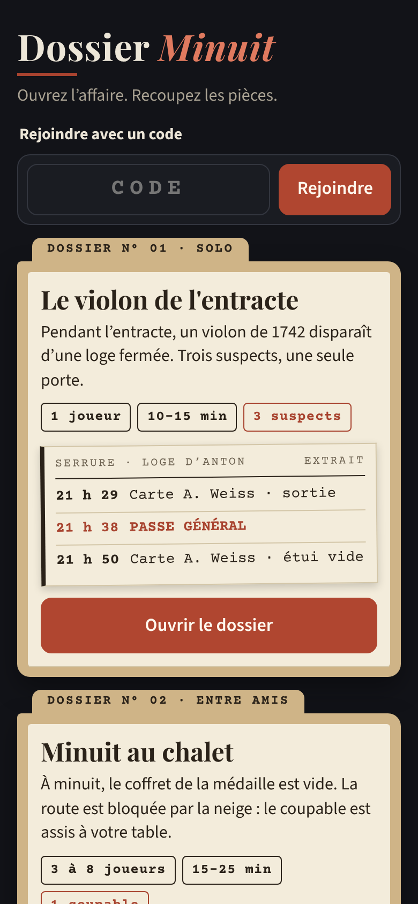
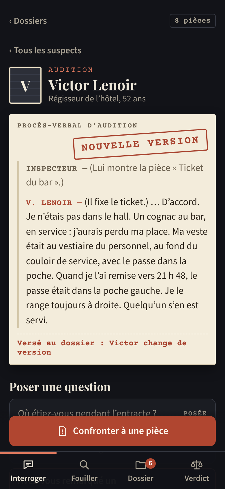
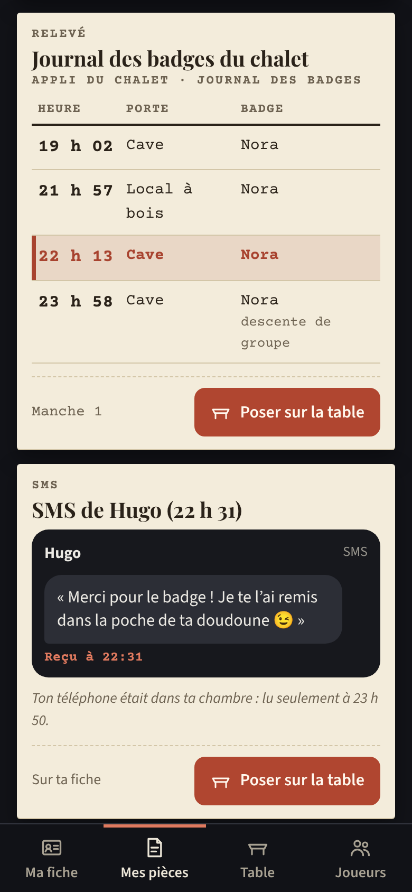

# Dossier Minuit — prototype

Jeu d’enquête courte sur téléphone, en français. Contenu entièrement fictif.

| Mode | Affaire | Joueurs | Durée |
|---|---|---|---|
| Solo | *Le violon de l’entracte* (3 suspects) | 1 | 10–15 min |
| Entre amis | *Minuit au chalet* (personnages selon le nombre de joueurs) | 3–8 | 15–25 min |

Aucune dépendance, aucun compte, aucune clé d’API. Les parties sont gardées en mémoire : si tu arrêtes le serveur, elles sont effacées.

## Aperçu (390 px de large)

| Accueil | Interrogatoire | Preuve multijoueur |
|---|---|---|
|  |  |  |

Direction visuelle : fond encre, pièces sur papier ivoire, repères rouge brique. Polices incluses dans `public/fonts` (licence SIL OFL) : Playfair Display (titres), Courier Prime (relevés, tampons), Source Sans 3 (texte).

## Démarrer (Windows)

1. Installe **Node.js 18 ou plus** (version LTS) : https://nodejs.org
2. Dans le dossier du projet (PowerShell ou terminal VSCode) :

```bash
npm start
```

3. Ouvre **http://localhost:3000** sur le PC.

Alternative : double-clic sur `Lancer-Dossier-Minuit.bat`.

Le terminal affiche aussi l’adresse Wi-Fi, par exemple `http://192.168.1.42:3000`.

## Jouer sur des téléphones (même Wi-Fi)

1. Le PC et les téléphones doivent être sur le **même Wi-Fi**.
2. Au premier lancement, Windows demande d’autoriser Node.js : coche **Réseaux privés** puis **Autoriser**.
   - Si tu as cliqué sur Annuler : Pare-feu Windows Defender → Autoriser une application → coche « Node.js » (réseau privé).
3. Sur le PC : dossier *Minuit au chalet* → **Créer une partie**. La salle affiche un code à 4 lettres et un lien en `http://192.168.x.x:3000/…`.
4. Sur chaque téléphone : ouvre ce lien (ou l’adresse Wi-Fi, puis tape le code dans **Rejoindre avec un code**) et entre un pseudo.
5. Dès qu’il y a 3 à 8 joueurs, l’hôte appuie sur **Distribuer les fiches**.

Si un téléphone ne charge pas la page : vérifie que le Wi-Fi est en profil « Privé » sur le PC et que l’adresse commence bien par `192.168.` ou `10.`.

## Simuler 3 joueurs sur le PC (plusieurs onglets)

Chaque onglet garde son propre joueur (stockage par onglet).

1. Onglet 1 : http://localhost:3000 → dossier *Minuit au chalet* → **Créer une partie** → pseudo « Hôte ». Note le code (ex. `K7MP`).
2. Onglet 2 : **ouvre un nouvel onglet** (Ctrl+T, pas « Dupliquer l’onglet ») → http://localhost:3000/#/rejoindre/K7MP → pseudo « Joueur 2 ».
3. Onglet 3 : pareil → pseudo « Joueur 3 ».
4. Onglet 1 : **Distribuer les fiches**.

Astuce : appuie sur F12 puis Ctrl+Maj+M pour avoir un affichage téléphone dans Chrome ou Edge.

## Déroulement de *Minuit au chalet*

| Étape | Qui | Ce qui se passe |
|---|---|---|
| Salle d’attente | Hôte | Partage le code ou le lien, démarre entre 3 et 8 joueurs |
| Manche 1 | Tous | Fiche privée : personnage, alibi, secret, indice + 1 indice. Présentations à voix haute |
| Manche 2 | Hôte → tous | Chaque téléphone reçoit un nouvel indice. Confrontations |
| Vote | Tous | Vote secret. L’hôte peut terminer le vote si quelqu’un est parti (les absents s’abstiennent) |
| Révélation | Tous | Résultat, coupable, mobile, chronologie, preuves clés, secrets de chacun |

- Le groupe gagne si **plus de la moitié des votants** désigne le coupable. Sinon, le coupable gagne.
- **Poser sur la table** : un joueur peut montrer une de ses pièces à tout le monde.
- **Actualiser la page** : le joueur retrouve son rôle et la manche en cours.
- Joueur parti : l’hôte peut le **marquer comme parti** (onglet Joueurs). Son vote n’est plus attendu.

## Vérification automatique

```bash
npm test
```

Ce test vérifie : le parcours solo complet (avec les changements de version), et des parties simulées de 3 à 8 joueurs (rôles distincts, hôte joueur, indices privés, cohérence des fiches, rechargement, départ d’un joueur, vote, révélation).

## Structure

| Fichier | Rôle |
|---|---|
| `server.js` | Serveur HTTP + API des salles (en mémoire). Envoie à chaque joueur uniquement sa vue |
| `game/chalet.js` | Affaire multijoueur (reste côté serveur) |
| `public/solo-data.js` | Affaire solo |
| `public/app.js`, `public/style.css` | Interface web mobile |
| `test/verif.js` | Vérifications automatiques |
